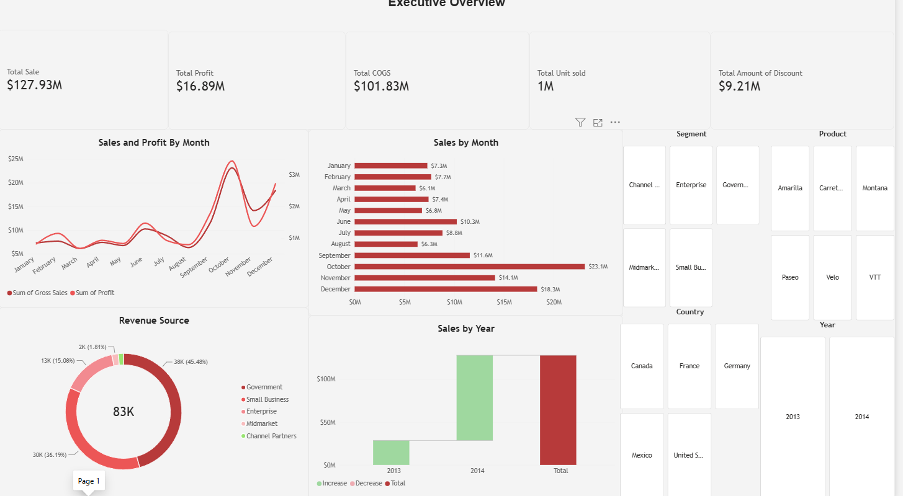
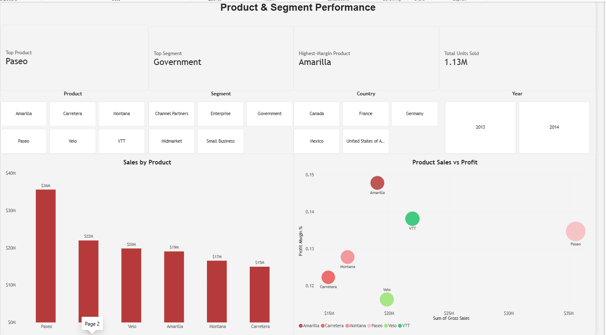
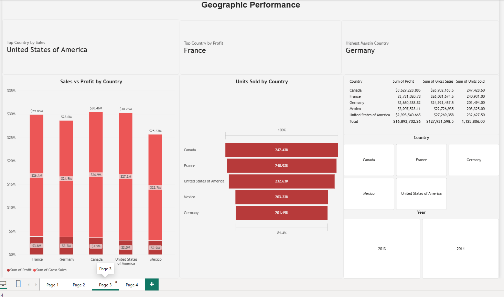
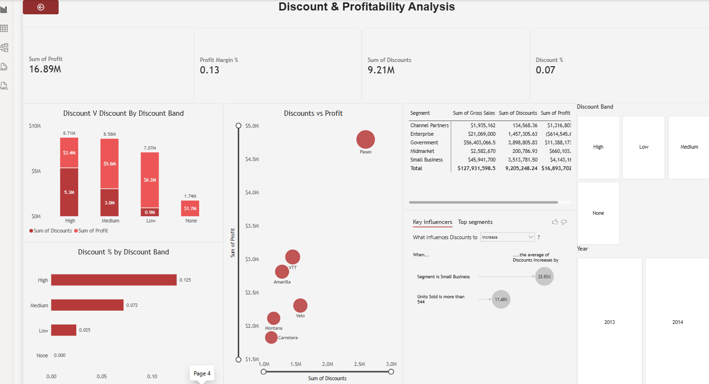

# 📊 Financial Sales & Profitability Dashboard — Power BI

## Dashboard Preview

### Executive Overview

### Product & Segment Performance

### Geographic Performance

### Discount & Profitability Analysis

---

## Project Overview

This project analyzes financial sales data using **Microsoft Power BI** to understand overall business performance, product profitability, geographic performance, discount impact, and customer segments.

The dashboard contains **four interactive pages**:

1. **Executive Overview**
2. **Product & Segment Performance**
3. **Geographic Performance**
4. **Discount & Profitability Analysis**

The goal was to turn raw financial data into a clear business dashboard that helps users quickly identify strong products, profitable markets, important sales trends, and areas that may require attention.

---

## Key Performance Indicators

| KPI | Result |
|---|---:|
| **Total Sales** | **$127.93M** |
| **Total Profit** | **$16.89M** |
| **Total COGS** | **$101.83M** |
| **Total Units Sold** | **1.13M** |
| **Total Discounts** | **$9.21M** |
| **Profit Margin** | **~13%** |
| **Average Discount Rate** | **~7%** |

---

# Page 1 — Executive Overview

This page provides a high-level view of overall business performance.

### Key Findings

- Total sales reached **$127.93M**.
- The business generated **$16.89M in profit**.
- Total product cost was approximately **$101.83M**.
- More than **1.1 million units** were sold.
- Discounts reduced revenue by approximately **$9.21M**.
- **October** was the strongest sales month at approximately **$23.1M**.
- November and December also showed strong sales performance.

The page also allows users to filter results by:

- Segment
- Product
- Country
- Year

---

# Page 2 — Product & Segment Performance

This page focuses on which products and customer segments drive the business.

### Key Findings

**Paseo** was the top-selling product, generating approximately **$36M in sales**.

Other major products included:

- Carretera — **~$22M**
- Velo — **~$20M**
- Amarilla — **~$19M**
- Montana — **~$17M**
- Carretera — **~$15M**

The dashboard identifies:

- **Top Product:** Paseo
- **Top Segment:** Government
- **Highest-Margin Product:** Amarilla
- **Total Units Sold:** 1.13M

The **Product Sales vs Profit** scatter chart makes it easier to compare products based on both revenue and profitability.

### Business Insight

A product with the highest sales is not automatically the product with the highest margin.

For example, **Paseo leads in sales**, while **Amarilla has the strongest profit margin**.

This distinction is important when deciding which products should receive more investment or pricing attention.

---

# Page 3 — Geographic Performance

This page compares sales, profit, and unit volume across countries.

### Key Findings

- **Top Country by Sales:** United States of America
- **Top Country by Profit:** France
- **Highest-Margin Country:** Germany

Country sales were relatively close, ranging from approximately **$25.6M to $30.5M**.

### Units Sold by Country

- Canada — **247.43K**
- France — **240.93K**
- United States — **232.63K**
- Mexico — **203.33K**
- Germany — **201.49K**

Canada sold the most units, while the United States generated the highest total sales.

### Business Insight

This shows that **sales volume, total revenue, and profitability do not always move together**.

A country may sell more units but still generate less revenue or profit depending on product mix, pricing, discounts, and margins.

---

# Page 4 — Discount & Profitability Analysis

This page examines how discounts affect profitability.

### Key Metrics

- **Total Profit:** $16.89M
- **Profit Margin:** ~13%
- **Total Discounts:** $9.21M
- **Average Discount Rate:** ~7%

### Discount Bands

The dashboard groups discounts into:

- High
- Medium
- Low
- None

The **High discount** category generated the largest total discount amount, while the **Low discount** category maintained a much stronger relationship between discount spending and profit.

### Product Discount vs Profit

The scatter chart compares product discounts with profit.

**Paseo** stands out with both the highest discount amount and the highest profit among the displayed products.

### Key Influencers

The dashboard also uses Power BI's **Key Influencers** visual to identify factors connected to higher discount values.

This adds an analytical layer beyond standard charts by helping explain **why discounts increase**.

---

## Business Recommendations

### 1. Protect high-performing products

Paseo generates the highest sales and strong profit, so it should remain a major focus.

At the same time, Amarilla's stronger margin suggests it may offer better profitability per dollar of sales.

### 2. Review discount strategy

With more than **$9M in discounts**, discounting has a meaningful impact on financial performance.

The business should compare discount levels against profit to determine whether larger discounts are actually generating enough incremental sales.

### 3. Focus on profitable markets

The United States leads sales, France leads profit, and Germany has the strongest margin.

This suggests that geographic strategy should consider **profitability as well as revenue**.

### 4. Use monthly trends for planning

October, November, and December show strong sales activity.

These periods may require additional inventory, staffing, or marketing support.

### 5. Compare volume with profitability

High unit sales do not always equal high profit.

Product and country decisions should consider:

- Revenue
- Profit
- Margin
- Units sold
- Discount level

together rather than evaluating only one metric.

---

## Power BI Skills Demonstrated

This project demonstrates practical experience with:

- **Microsoft Power BI**
- **Power Query**
- **Data Cleaning & Transformation**
- **DAX Measures**
- **KPI Cards**
- **Bar and Line Charts**
- **Waterfall Charts**
- **Scatter Plots**
- **Donut Charts**
- **Slicers**
- **Interactive Filters**
- **Key Influencers**
- **Financial Analysis**
- **Profitability Analysis**
- **Dashboard Design**
- **Business Storytelling**

---

## Future Improvements

Future versions of the dashboard could include:

- Year-over-year growth percentages
- Profit margin by segment
- Discount effectiveness analysis
- Top and bottom product rankings
- Monthly sales forecasting
- Budget vs actual performance
- Drill-through product pages
- Custom tooltips
- Customer-level profitability analysis

---

## Tools Used

**Power BI | Power Query | DAX | Financial Analysis | Data Visualization | Dashboard Design**

---

## Author

**Mohammad**

Portfolio:  
https://mohammad0104.github.io/
